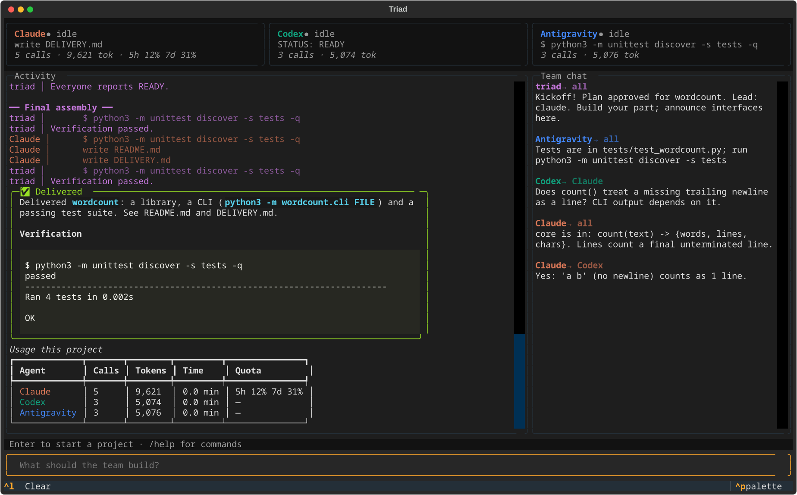

# Triad: an AI company in your terminal

You describe a project once. A team of **Claude Code, Codex and Antigravity** members runs it like a
small company: software, research, analysis, data, websites, writing, or all of them at once.
You pick the team (any mix, any size), and the lead can hire or bench members as the work requires.

The **lead** (Claude by default) acts as managing director. It reads the request and the team's ideas,
then designs the workflow: which kinds of work the project needs, in what order, and who does what.

| Stage type | What happens |
|---|---|
| 🔎 **research** | members gather facts and data from the web, documents and APIs, and write sourced notes |
| 🛠 **build** | members create artifacts in parallel: code, websites, datasets, documents |
| ⚖ **debate** | members argue assigned positions over rounds, ending early once they converge, to find the cruxes |
| 🎲 **simulate** | role-play wargames: members play real-world actors, a game master resolves each turn |

A software project is usually one build stage. A forecast might be research → debate → simulate.
A data dashboard might be research → build.

```
 you ──▶ request
          ▼
   Brainstorm        all three propose an approach in parallel (read-only)
          ▼
   Plan              the lead designs the stages and splits work EVENLY  ──▶ you approve / revise
          ▼
 ┌▶ Stage            research / build / debate / simulate, all three in parallel, talking on the team chat
 │   ├─ check-in       (research/build) each posts a plan of attack ──▶ ONE lead direction check
 │   ├─ ask            anyone can ask the lead about real ambiguity (questions are batched)
 │   └─ halt           the lead can stop one member (restart with a correction) or everyone (replan)
 │        ▼
 │  Lead review      checks the stage, writes a summary for later stages, requests targeted fixes,
 └── and adapts      and may add, drop or change the remaining stages based on what was learned
          ▼
   Final assembly    the lead compiles the deliverable + README + DELIVERY.md
```

Every stage leaves a trail in `work/NN-stage-name/`: research notes, `debate.md`, one file per
simulated scenario, and the lead's `SUMMARY.md`.

**Why three:** each subscription has its own allowance, so splitting work evenly gives you
roughly 3× the capacity of one, and three model families bring more varied ideas than one.
If one runs out of usage mid-project, the teammate with the most headroom takes its seat.

## Install

Needs Linux or macOS, Python 3.11+, git, and at least one of the official CLIs, installed and
signed in with your own account:

| Agent       | CLI      | Sign in              |
|-------------|----------|----------------------|
| Claude Code | `claude` | `claude` then `/login` |
| Codex       | `codex`  | `codex login`        |
| Antigravity | `agy`    | `agy` (Google sign-in) |

```bash
bash scripts/install.sh      # installs the `triad` command (uses uv, pipx, or a private venv)
triad doctor --ping          # checks all three respond (sends each a one-line prompt)
```

## Use it

```bash
mkdir ~/pomodoro && cd ~/pomodoro
triad
```

Type what you want and press Enter, for example:

- *Build a pomodoro timer web app with session history and a dark mode*
- *Research the EV charging market in Korea, debate the outlook, and build a small dashboard of the data*
- *How will this week's midterm results shape US trade policy for the rest of 2026? Research, debate,
  and simulate how key players respond. Deliver a brief with probabilities.*



- **Top:** a live card for each member: what it's doing right now, its calls and tokens, and Claude's real
  5-hour/7-day quota.
- **Middle, summary view (default):** a clean timeline: the plan summary, stage milestones, the lead's
  review verdicts, and a progress report every minute or so, written by a reporter member
  (Antigravity when it's on the team). Raw tool calls, chat and logs are hidden.
- **Ctrl+O, detail view:** everything: every command and file edit, by whom, plus the team chat.
- **Bottom:** your input. While the team works, **what you type goes only to the lead**. Ask "how's it
  going?" or "why is Codex rewriting the parser?", or change direction ("make it a web app instead"). The lead
  answers you, then picks the least disruptive fix: a note to the members concerned, stopping and redirecting
  one member, reshaping the remaining stages, or a full pivot (everyone stops, you approve a revised plan).
  Your instruction becomes a requirement every member follows from then on. `/status` gives an instant
  summary without any AI call. `/all <msg>` or `/to codex <msg>` reach the team directly.

When the plan appears you get the lead's plain-language summary and **what it needs from you**.
Press **Enter** to start, or type answers and changes (*"1: yes, 2: use SQLite"*) and the lead revises the plan.
`/details` shows the full plan and everyone's brainstorm.

Commands: `/help`, `/team [claude,codex,…]`, `/stop`, `/to codex-2 <msg>`, `/lead codex`, `/rounds 2`, `/reviews 3`,
`/brainstorm off`, `/clear`, `/quit`.

### Picking up where you left off

Triad saves each project's state in `.triad/state.json`: the plan, finished stages and the lead's summaries,
the team, and your answers. If you close the app or it crashes mid-project, launch `triad` in the same
folder. It offers to resume, and Enter continues at the stage that was interrupted, with finished stages
skipped and work already on disk kept. `triad resume` does the same without the full-screen UI.

If the last project here was delivered, your next request is treated as a follow-up ("now add a dark
mode"). The team gets the previous project's summary and builds on it instead of starting over. Earlier
projects are archived in `.triad/history/`.

### Without the full-screen UI

```bash
triad run "Build a CLI that converts Markdown to a static site"      # streams to stdout, asks before starting
triad run --yes "..."                                                # no approval prompt (for scripts)
triad run -v "..."                                                   # print every action, not just the summary
triad -C ~/somewhere "..."                                           # different folder
```

### Try it without spending any usage

```bash
mkdir /tmp/triad-demo && cd /tmp/triad-demo && triad --demo
```

`--demo` swaps in offline stand-ins that speak the exact output formats of the three CLIs.
The full pipeline runs on a toy project: brainstorm, a four-stage plan (research, debate, simulation,
build), team chat, questions, reviews, fixes, and delivery.

## How the lead manages without wasting usage

The lead is one of the three CLIs (Claude by default) acting as manager in separate, read-only calls.
Every lead call is triggered by an event and capped; nothing runs on a timer:

| Lead action | Triggered when | Cost control |
|---|---|---|
| Direction check | everyone has checked in early in a research/build stage (or 5 min passed) | once per stage; usually just "on track" |
| Answer questions | an engineer runs `ask` | questions arriving within 8 s share one call; 8 calls per project, then "use your judgment" for free |
| Halt one engineer | a check-in or question shows a costly wrong direction | max 2 per engineer, then it becomes a note |
| Halt everyone + replan | the plan itself is wrong | max 1 per project; you approve the new plan |
| Stage review | after every stage | one call; approve unless real problems; max 2 fix cycles; only members with feedback do a fix turn |
| Adapt workflow | in a stage review, when results change what's needed | free (part of the review); max 6 stages in total |

Engineers are told to ask only about ambiguity that changes what they build, and to decide small
details themselves. Tune with `triad config review_rounds 1`, `lead_answer_budget 4`,
`direction_check false`, `max_replans 0`, etc.

## How the agents talk

Each agent gets a tiny chat tool in the workspace (`.triad/msg.py`). Since all three CLIs can run
shell commands, they use it like colleagues use Slack:

```
python3 .triad/msg.py --as codex send claude "Does count() treat a missing trailing newline as a line?"
python3 .triad/msg.py --as claude inbox
python3 .triad/msg.py --as claude send codex "Yes: 'a b' counts as 1 line."
python3 .triad/msg.py --as codex checkin "CLI in tipcalc/cli.py, argparse, calls core.split_bill()"
python3 .triad/msg.py --as codex ask "Should 'up' rounding apply per person or to the total?"   # waits for the lead
```

They are told to announce interfaces as soon as they define them, ask instead of editing each
other's files, answer questions promptly, and never block for long. Between rounds Triad also passes
everyone's handoff reports (what I built / interfaces / how to test / open issues) to everyone else.

## Safety and git

- Agents run **in the folder you start Triad in**, as your user, and may run commands there
  (installing packages, running tests). Use a dedicated project folder; Triad refuses `~` and `/`.
- Brainstorm and planning are read-only. Codex builds inside its `workspace-write` sandbox;
  Claude gets `acceptEdits` plus shell; Antigravity gets `accept-edits` plus shell commands.
- The folder becomes a git repo and **every phase is a commit**, so you can `git diff` or roll back.
  In an existing clean repo, Triad works on a new `triad/<project>-<time>` branch and never touches
  your branch. If you have uncommitted changes, Triad still works but makes no commits.
- Team chat and plan live in `.triad/` (git-ignored).

## The team

By default the team is one member per installed CLI. Choose any mix and size instead:

```bash
triad --team claude,codex,claude          # this run only: two Claude sessions + Codex, no Antigravity
triad config team claude,codex,codex      # save as your default
triad config team codex:gpt-6-astra,claude   # pin a model per member
triad config team default                 # back to one of each
```

In the app, `/team` shows the team and `/team claude,codex,claude` changes it. Members are named
after their CLI: `claude`, `codex`, `claude-2`, and so on.

**The lead staffs the project.** In the plan, and at any stage review, the lead can hire extra
members when work parallelises (up to `max_team`, default 5) or bench members a stage doesn't need.
It can only hire CLIs that are already on your team, so if you leave Antigravity out, it stays out.
Hires and benches show up in the activity feed, and each member gets its own card.

**Usage is per subscription.** Two Claude members share one Claude allowance, so a second Claude
member adds parallel work, not allowance. Triad tracks quota per subscription, tells the lead which
members share one, and when a subscription runs out, all its members stand down and members on
other subscriptions take their seats.

## Skills

Skills are Markdown files of know-how that the lead can attach to any stage. Built in:
`forecasting`, `data-collection`, `website`, `report-writing`. Add your own in `~/.config/triad/skills/`,
one file per skill. The first line says what it is for, and the rest is the guidance, for example
`~/.config/triad/skills/korean-market.md`. A file with the same name as a built-in skill replaces it.

Every member also has web search: Claude's WebSearch/WebFetch, `codex --search`, and Antigravity's
`search_web`. Turn it off with `triad config web false`.

## Settings

`triad config` shows everything (`~/.config/triad/config.json`). Examples:

```bash
triad config lead codex                  # who plans and assembles (default: claude)
triad config sync_rounds 2               # peer integration rounds (default 1)
triad config review_rounds 3             # lead review -> fix cycles (default 2)
triad config brainstorm false            # skip the idea round to save usage
triad config codex.model gpt-5.5         # pin a model per agent
triad config team claude,codex           # run with just two members
triad config max_team 4                  # how big the lead may grow the team
triad config narrator off                # no progress reports (or a member: narrator codex)
triad config narrator_interval 120       # at most one report every 2 minutes
triad config turn_timeout 3600           # seconds per agent turn
```

## Development

```bash
uv venv && uv pip install -e '.[dev]'
.venv/bin/python -m pytest -q
```

| File | What it does |
|------|--------------|
| `triad/agents.py`  | launches each vendor CLI and parses its live JSON stream; usage and quota tracking |
| `triad/company.py` | the company: plan, stage engine (research/build/debate/simulate), lead supervision, reviews, failover |
| `triad/skills_loader.py`, `triad/skills/` | built-in and user skills |
| `triad/prompts.py` | everything the agents are told |
| `triad/bus.py`     | the team chat board and the `msg.py` tool |
| `triad/tui.py`     | the terminal app (Textual) |
| `triad/cli.py`     | `triad`, `triad run`, `triad doctor`, `triad config` |
| `triad/fake_agent.py` | offline stand-in used by `--demo` and the tests |

Triad uses each vendor's official CLI with your own sign-in; it doesn't touch credentials or use API keys.
Usage counts against your normal plan limits. MIT licensed.
